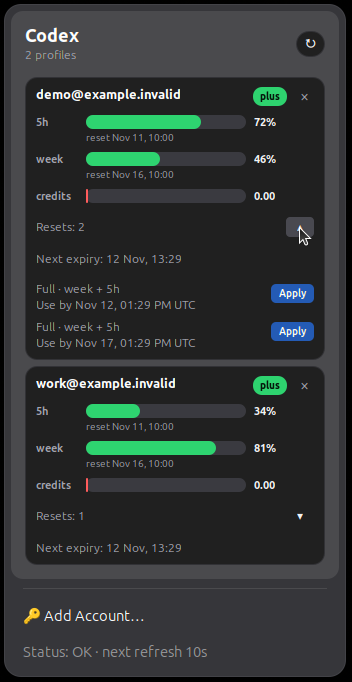
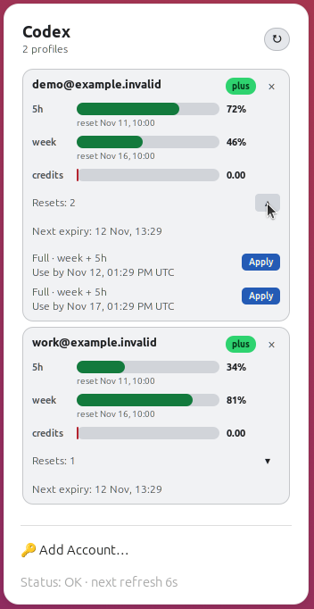
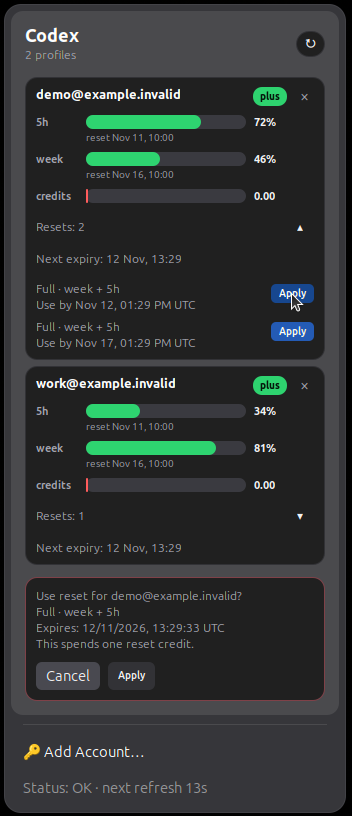
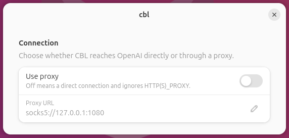

# CBL — Codex Bar for Linux

See your ChatGPT/Codex usage limits in the **GNOME top bar**: one popup, multiple accounts, no separate main window and no Codex CLI requirement.

[Русская версия](README.ru.md) · [Latest release](https://github.com/tarantsevm/cbl/releases/latest)

## At a glance

- Per-account **5-hour, weekly and credits** meters, when reported by the provider.
- Local reset dates beneath each usage window.
- Automatic light/dark palettes, including meters, buttons and confirmation controls.
- Quiet healthy cards; compact, actionable login and connection errors.
- Automatic refresh every minute and throttled manual refresh.
- Device-code login from the popup; multiple accounts supported.
- Expiring manual reset offers, with individual **Use by** deadlines and guarded **Apply** actions.
- Confirmed account removal without deleting the OpenAI account or shared Codex CLI authorization.
- App-specific proxy settings and a local HTTP/Waybar API.

## Screenshots

These are captures of the real GNOME Shell extension, using **synthetic demo accounts and usage data**, not real account activity. The settings view uses a loopback example. No credentials or live account identifiers are shown.

### Automatic dark and light palettes

<p align="center">
  <a href="docs/assets/cbl-dark.png"></a>
  <a href="docs/assets/cbl-light.png"></a>
</p>

Healthy cards stay quiet. Scheduled window renewal is shown below its meter; an offer's **Use by** deadline is a separate expiration time. The small disclosure arrow expands the individual offers.

### Explicit confirmation before applying a reset



**Apply** first opens a separate confirmation, with **Cancel** focused. The backend revalidates the account and offer, prevents duplicate submissions and checks the provider's state afterward. An uncertain attempt remains guarded across restarts instead of being silently retried.

**Verification boundary:** the complete redemption flow is implemented and tested against a local simulated provider. Real OpenAI reset consumption was deliberately not executed during testing. Final confirmation can spend a real reset credit; do not confirm just to preview the UI. Offers appear only when supported data is available; an ordinary scheduled reset is not a manual credit.

### Connection settings



Open **GNOME Extensions → cbl → Settings → Connection**. Enable a proxy and enter an `http://`, `https://`, `socks5://` or `socks5h://` URL. With **Use proxy** off, CBL connects directly and ignores saved and service-level proxy settings. These controls affect CBL, not your browser or system routing. Refresh after saving to use the new settings immediately.

## What's new in v0.3.4

- Updated English/Russian documentation and real GNOME screenshots of adaptive themes, reset offers and confirmation.
- Public installation and project links use `tarantsevm/cbl`.
- Release builds omit build-machine paths and Git revision metadata. Archive ownership and timestamps are normalized.
- Existing v0.3.3 functionality is retained: adaptive palettes, compact errors, expiring reset offers and guarded redemption. This is a documentation/distribution update, not a newly verified live-provider integration.

## Install or update — Ubuntu / GNOME

```bash
curl -fsSL https://raw.githubusercontent.com/tarantsevm/cbl/main/install.sh | bash -s -- --systemd --extension
```

The prebuilt release targets **Linux amd64**. Use a source checkout for other architectures. Requirements: `bash`, `curl`, `tar`, `python3`, a systemd user session and a supported GNOME Shell (45–50 declared by the extension).

**Do not uninstall before upgrading.** Updates preserve saved accounts and proxy settings, including when updating an older CBL installation. On **GNOME Wayland**, log out and back in after installation/update so Shell reloads the extension.

If necessary:

```bash
systemctl --user restart cbl.service
gnome-extensions enable cbl@codex-limits
gnome-extensions info cbl@codex-limits
```

Expected extension state: `ACTIVE`.

## Add and manage accounts

1. Open the `•••` top-bar indicator and choose **Add Account…**.
2. CBL opens the OpenAI device confirmation page in your browser.
3. Click the popup's **Code** row to copy the one-time code; enter it in the browser.
4. After browser confirmation, click **I confirmed login** in the popup.
5. Repeat for additional accounts. Each account gets a separate card.

The header refresh button updates all cards; repeated clicks are throttled. Cards distinguish login-required, connection failures and missing data without dumping raw server responses into the popup.

To remove an account, click **×**, then confirm. Cancel is focused by default. Removal deletes CBL-owned credentials and suppresses automatic re-import; shared Codex CLI authorization is preserved. This does **not** delete your OpenAI account or revoke remote sessions. Use **Add Account…** explicitly to add it again.

## Local commands and API

```bash
cbl version
cbl status
cbl status --json
cbl status --waybar
cbl serve --addr 127.0.0.1:18088
```

The user service exposes a loopback API:

```bash
curl http://127.0.0.1:18088/api/status
curl http://127.0.0.1:18088/waybar
```

The extension uses this API. **Keep it on loopback; do not expose it to your LAN or the Internet.** It is a local user interface, not an authenticated remote management service. Non-GNOME desktops may use the optional AppIndicator fallback or Waybar output; the GNOME popup is the primary UI.

## Build and test

Go 1.23+, Node.js (UI tests), Python 3, Bash and standard GNU/Linux packaging tools are required. The tray fallback optionally uses `libayatana-appindicator3-dev` at runtime.

```bash
git clone https://github.com/tarantsevm/cbl.git
cd cbl
make test
go vet ./...
go build -trimpath -buildvcs=false -o cbl ./cmd/cbl
go build -trimpath -buildvcs=false -o cbl-tray ./cmd/cbl-tray
./install.sh --systemd --extension
```

Build release archives or just the extension:

```bash
VERSION=v0.3.4 ./release/package-release.sh
./install/ubuntu/package-gnome-extension.sh
```

Unit/integration tests use local fixtures. Optional GUI tests can be skipped when their explicit prerequisites are absent; a skipped GUI test is not proof of desktop acceptance. Screenshots show actual GNOME, not a substitute GTK window or HTML mockup.

## Files and privacy

CBL uses per-user files:

- `~/.local/bin/cbl` and `~/.local/bin/cbl-tray`
- `~/.config/systemd/user/cbl.service`
- `~/.config/cbl/config.json`
- `~/.config/cbl/accounts/*.json`
- `~/.local/share/gnome-shell/extensions/cbl@codex-limits`

Account files contain sensitive authentication data. Do not share this directory, real API responses, device codes or screenshots of real account identifiers. CBL still communicates with the provider to log in and fetch usage; it does not make provider activity anonymous.

Environment overrides: `CBL_AUTH_FILE` (legacy single-account authorization), `CBL_CONFIG_FILE`, `CBL_BASE_URL`, `CBL_FIXTURE` (offline test/development data).

## Full uninstall

**This deletes CBL's saved accounts and configuration**, as well as its user service, binaries, tray autostart and extension:

```bash
curl -fsSL https://raw.githubusercontent.com/tarantsevm/cbl/main/uninstall.sh | bash
```

## License

CBL is available under the [MIT License](LICENSE), copyright CBL contributors. Bundled dependency notices are in [THIRD_PARTY_NOTICES.txt](THIRD_PARTY_NOTICES.txt); those components retain their original licenses.

CBL is an unofficial client and is not affiliated with or endorsed by OpenAI. Provider endpoints and reset availability may change.
