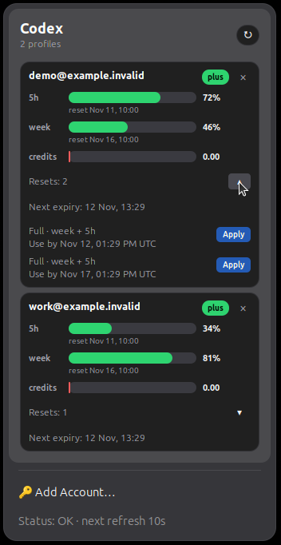
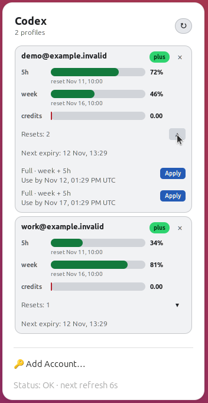
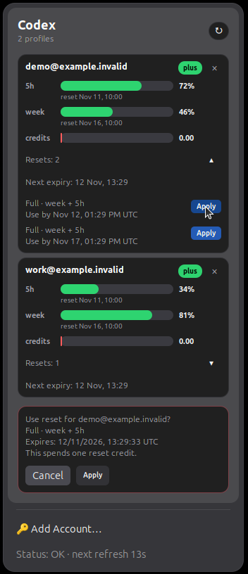
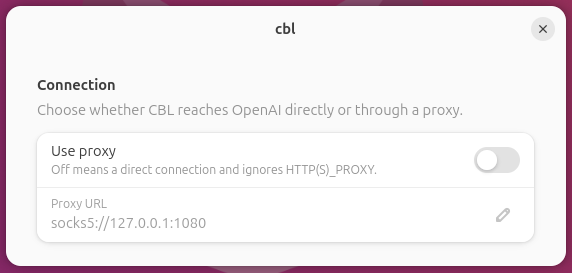

# CBL — Codex Bar for Linux

Лимиты ChatGPT/Codex в **верхней панели GNOME**: один popup, несколько аккаунтов, без отдельного главного окна и обязательной установки Codex CLI.

[English README](README.md) · [Последний релиз](https://github.com/tarantsevm/cbl/releases/latest)

## Возможности

- Отдельные шкалы **5h, week и credits** для каждого аккаунта, если провайдер отдаёт эти данные.
- Локальные дата и время обновления каждого окна лимитов.
- Автоматическая светлая/тёмная палитра: карточки, шкалы, кнопки и подтверждения.
- Спокойные здоровые карточки; компактные понятные ошибки входа и соединения.
- Автообновление каждую минуту и ручной refresh с ограничением частых нажатий.
- Встроенный device-code login и поддержка нескольких аккаунтов.
- Ручные сбросы с отдельными сроками **Use by** и защищёнными действиями **Apply**.
- Удаление аккаунта с подтверждением, без удаления аккаунта OpenAI и общей авторизации Codex CLI.
- Настройки прокси только для CBL и локальный HTTP/Waybar API.

## Скриншоты

Это снимки **настоящего расширения GNOME Shell** с синтетическими демонстрационными аккаунтами и лимитами, а не активностью реальных аккаунтов. В настройках показан loopback-пример. Учётных данных и настоящих идентификаторов аккаунтов на снимках нет.

### Автоматические светлая и тёмная темы

<p align="center">
  <a href="docs/assets/cbl-dark.png"></a>
  <a href="docs/assets/cbl-light.png"></a>
</p>

Здоровые карточки не перегружены статусами. Плановое обновление окна показано под шкалой, а **Use by** — отдельный срок, до которого можно использовать ручной сброс. Маленькая стрелка раскрывает список предложений.

### Подтверждение перед применением сброса



**Apply** сначала открывает отдельное подтверждение с фокусом на **Cancel**. Backend заново проверяет аккаунт и предложение, защищает от двойной отправки и проверяет состояние у провайдера после запроса. Неопределённая попытка остаётся заблокированной и после перезапуска, а не повторяется автоматически.

**Граница проверки:** полный путь применения реализован и протестирован на локальном имитаторе провайдера. Настоящие сбросы OpenAI при тестировании намеренно не выполнялись. Финальное подтверждение может потратить реальный сброс — не подтверждай ради просмотра интерфейса. Блок появляется только при наличии поддерживаемых данных; обычное обновление окна лимитов не является ручным сбросом.

### Настройки соединения



Открой **GNOME Extensions → cbl → Settings → Connection**. Включи прокси и укажи URL вида `http://`, `https://`, `socks5://` или `socks5h://`. С выключенным **Use proxy** CBL подключается напрямую, игнорируя сохранённые и сервисные proxy-настройки. Эти настройки не меняют браузер и системную маршрутизацию. После сохранения обнови popup, чтобы применить их сразу.

## Что нового в v0.3.4

- Обновлены английское/русское описания и реальные скриншоты тем, ручных сбросов и подтверждения.
- Публичные ссылки проекта и установки переведены на `tarantsevm/cbl`.
- Release-сборки не содержат путей машины сборки и Git revision metadata; владельцы и временные метки архивов нормализованы.
- Возможности v0.3.3 сохранены: адаптивные темы, компактные ошибки, истекающие предложения сбросов и защищённое применение. Это обновление документации и дистрибуции, а не новая проверка расходования у настоящего провайдера.

## Установка / обновление — Ubuntu / GNOME

```bash
curl -fsSL https://raw.githubusercontent.com/tarantsevm/cbl/main/install.sh | bash -s -- --systemd --extension
```

Готовые пакеты рассчитаны на **Linux amd64**. Для другой архитектуры собирай из исходников. Требуются `bash`, `curl`, `tar`, `python3`, systemd user session и поддерживаемый GNOME Shell (в расширении заявлены 45–50).

**Не удаляй CBL перед обновлением.** Обновление сохраняет аккаунты и proxy, в том числе при переходе с прежней установки. На **GNOME Wayland** после установки/обновления выйди из сеанса и войди снова, чтобы Shell загрузил расширение заново.

Если нужно:

```bash
systemctl --user restart cbl.service
gnome-extensions enable cbl@codex-limits
gnome-extensions info cbl@codex-limits
```

Ожидаемое состояние расширения: `ACTIVE`.

## Вход и управление аккаунтами

1. Открой индикатор `•••` и выбери **Add Account…**.
2. CBL откроет в браузере страницу подтверждения OpenAI.
3. Нажми строку **Code**, чтобы скопировать одноразовый код, и введи его в браузере.
4. После подтверждения в браузере нажми **I confirmed login** в popup.
5. Повтори для других аккаунтов — каждый получает отдельную карточку.

Кнопка refresh в заголовке обновляет карточки, ограничивая частые нажатия. Ошибки входа, соединения и отсутствие данных различаются; сырые ответы сервера не растягивают popup.

Для удаления нажми **×**, затем подтверди. По умолчанию выбран Cancel. Удаление убирает принадлежащие CBL файлы авторизации и подавляет автоматический повторный импорт; общий с Codex CLI файл сохраняется. Это **не удаляет** аккаунт OpenAI и не отзывает удалённые сеансы. Для возврата явно используй **Add Account…**.

## Локальные команды и API

```bash
cbl version
cbl status
cbl status --json
cbl status --waybar
cbl serve --addr 127.0.0.1:18088
```

User service предоставляет loopback API:

```bash
curl http://127.0.0.1:18088/api/status
curl http://127.0.0.1:18088/waybar
```

Расширение использует этот API. **Оставляй его на loopback; не открывай в LAN или Интернет.** Это локальный интерфейс пользователя, а не защищённый удалённый сервис управления. Другие окружения могут использовать необязательный AppIndicator fallback или Waybar; основной UI — GNOME popup.

## Сборка и тесты

Нужны Go 1.23+, Node.js (UI-тесты), Python 3, Bash и стандартные инструменты упаковки GNU/Linux. Для tray fallback можно установить `libayatana-appindicator3-dev`.

```bash
git clone https://github.com/tarantsevm/cbl.git
cd cbl
make test
go vet ./...
go build -trimpath -buildvcs=false -o cbl ./cmd/cbl
go build -trimpath -buildvcs=false -o cbl-tray ./cmd/cbl-tray
./install.sh --systemd --extension
```

Release-архивы или отдельно расширение:

```bash
VERSION=v0.3.4 ./release/package-release.sh
./install/ubuntu/package-gnome-extension.sh
```

Unit/integration-тесты используют локальные fixtures. Необязательные GUI-тесты могут пропускаться без явно включённых предпосылок; такой пропуск не доказывает работу desktop-интеграции. Скриншоты сделаны в настоящем GNOME, а не в подменном GTK-окне или HTML-макете.

## Файлы и приватность

CBL использует пользовательские файлы:

- `~/.local/bin/cbl` и `~/.local/bin/cbl-tray`
- `~/.config/systemd/user/cbl.service`
- `~/.config/cbl/config.json`
- `~/.config/cbl/accounts/*.json`
- `~/.local/share/gnome-shell/extensions/cbl@codex-limits`

В файлах аккаунтов есть чувствительные данные авторизации. Не публикуй этот каталог, настоящие ответы API, device codes или скриншоты идентификаторов реальных аккаунтов. Для входа и получения лимитов CBL общается с провайдером и не делает эту активность анонимной.

Переменные: `CBL_AUTH_FILE` (legacy single-account auth), `CBL_CONFIG_FILE`, `CBL_BASE_URL`, `CBL_FIXTURE` (офлайн-данные для тестов/разработки).

## Полное удаление

**Удаляет сохранённые аккаунты и настройки CBL**, а также user service, бинарники, tray autostart и расширение:

```bash
curl -fsSL https://raw.githubusercontent.com/tarantsevm/cbl/main/uninstall.sh | bash
```

## Лицензия

CBL распространяется по [MIT License](LICENSE), авторское уведомление — CBL contributors. Лицензии включённых зависимостей сохранены в [THIRD_PARTY_NOTICES.txt](THIRD_PARTY_NOTICES.txt); для них действуют исходные условия.

CBL — неофициальный клиент, не связанный с OpenAI и не одобренный компанией. API провайдера и доступность сбросов могут изменяться.
